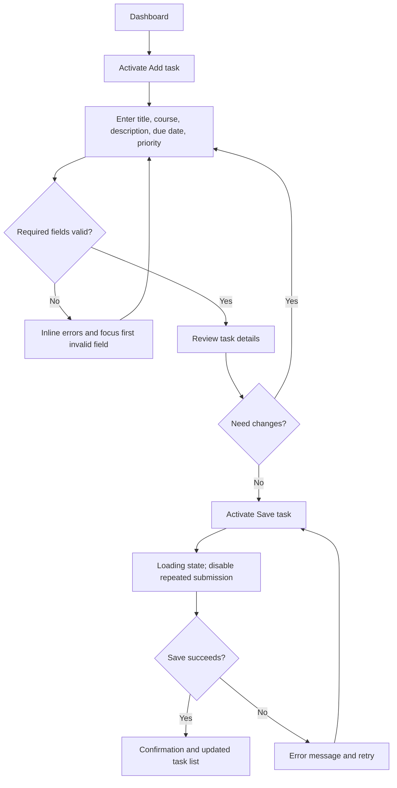

# CaseStudy 2 — Interactive Prototype Specification
## StudyFlow: Student Task Manager

**Status:** Prototype specification and implementation notes  
**Prototype technology:** HTML5, CSS3, vanilla JavaScript  
**Prototype URL:** Add the public GitHub Pages/Figma/Netlify URL after publishing.  
**Repository URL:** Add the public GitHub repository URL after publishing.

## 1. Purpose and scope

StudyFlow helps a student capture coursework, assign a course and due date, choose a priority, and track completion. This case study focuses on the multi-step **Create Task** flow rather than an entire student information system.

### User goal
Create a clearly described task with a course, due date, and priority, review the information, then save it and receive confirmation.

### Success criteria
- A user can create a task without a mouse.
- Missing or invalid required fields are identified next to the field and explain how to recover.
- A user can review and edit details before saving.
- Saving immediately provides processing feedback and blocks duplicate submission.
- Confirmation is announced to assistive technology.
- Interactive targets are designed to be at least 44 × 44 CSS pixels where practical.

## 2. Interaction flow

## 3. Screens and behavior

### Screen A — Dashboard
- Displays sample tasks, completion counts, filters, and search.
- **Add task** opens the task creation dialog.
- A checkbox toggles a task's completion state.
- Search and filters update the visible task list without a page reload.
- Empty results show an explanatory empty state and a create-task action.

### Screen B — Details
Fields:
- **Task title** — required, maximum 80 characters.
- **Course** — required, maximum 60 characters.
- **Description** — optional, maximum 300 characters.
- **Due date** — required; today or a future date is allowed.
- **Priority** — required radio group with Low, Medium, and High; Medium is the default.

The **Review task** button validates required fields. On failure, each invalid field receives `aria-invalid="true"`, its inline error becomes visible, and focus moves to the first invalid field. On success, the review step opens.

### Screen C — Review
A definition list summarizes all entered details. **Edit details** returns to the form without discarding values. **Save task** begins saving.

### Screen D — Confirmation
The prototype shows a success mark, a summary, and actions to view tasks or create another task. The dashboard list and counts update immediately.

## 4. Input mechanics mapping

| Input paradigm | Expected behavior | Specification |
|---|---|---|
| Mouse / pointing device | Click buttons, focus inputs, choose radio options, toggle completion | Clear hover state; controls have descriptive names |
| Keyboard | Tab and Shift+Tab through controls; Enter/Space activate buttons; arrows operate native radio controls | Visible high-contrast focus; logical DOM order; Escape closes dialog |
| Touch | Tap controls and select dates/options | Aim for 44 × 44 CSS px minimum target size; maintain separation between neighboring targets |
| Screen reader | Read headings, labels, required state, inline errors, dialog name, and status changes | Native semantic controls, `aria-describedby`, `aria-invalid`, `role="dialog"`, live status region |
| Voice control | Activate controls by visible labels such as “Add task,” “Review task,” and “Save task” | Keep visible text aligned with accessible names; avoid ambiguous duplicate labels |

Swipe or pinch gestures are not necessary for this flow and should not be required to complete any task.

## 5. Fitts' Law and target sizing

Primary controls are styled with a minimum height of 44 CSS pixels. The main action buttons are 46 CSS pixels high; icon-only close control is 44 × 44 CSS pixels; task checkboxes have a 23 × 23 visual glyph but are a native control. For strict target compliance, increase the checkbox's clickable label/wrapper to at least 44 × 44 CSS pixels before final submission and verify the rendered hit area in browser developer tools.

Target-sizing checklist:
- [ ] Primary and secondary buttons have at least a 44 px high hit area.
- [ ] Tab controls and priority choices have at least a 44 px high hit area.
- [ ] Search and form inputs have at least a 44 px high hit area.
- [ ] Adjacent controls have sufficient spacing to reduce accidental activation.
- [ ] Mobile layout is checked at narrow viewport widths.

## 6. Component state matrix

| Component | Default | Hover | Focus | Active / pressed | Disabled | Loading | Error |
|---|---|---|---|---|---|---|---|
| Primary button | Purple fill, white text | Darker purple | 3 px high-contrast outline | Slight downward movement / darker fill | Reduced opacity, no action | “Saving…” label and busy state | Error message appears near the action; retry remains possible |
| Text input | White field, neutral border | Border may strengthen | Visible outline | Native caret and selection | Not used for required fields in this prototype | Not applicable | Red border, `aria-invalid=true`, inline recovery text |
| Priority radio | Native radio and label | Label background changes | Native focus outline | Selected option changes | Not used | Not applicable | Form-level/field validation guidance if required |
| Task checkbox | Empty checkbox | Card border highlights | Visible keyboard outline | Checked state toggles | Not used | Not applicable | Not applicable |
| Search field | Placeholder visible | Border emphasis | Outline | Text entry | Not used | Not applicable | Empty result state explains no match |
| Task dialog | Hidden until requested | N/A | Initial focus moves into dialog | Buttons change workflow step | Close is blocked while saving | Save button disabled while request is pending | Save error appears with retry guidance |
| Live status | Empty | N/A | Not focusable by default | N/A | N/A | Announces processing | Announces validation or save failure |

**Note:** Hover is supplementary and must never be the only way to discover an action. Disabled states must not silently hide why an action is unavailable; where relevant, explain the missing requirement in visible text.

## 7. Semantic HTML and ARIA specification

The implementation uses:
- `<main>` for primary page content.
- `<nav aria-label="Main navigation">` for app navigation.
- `<section>` and heading elements to structure dashboard and dialog content.
- `<form>` for task entry, with associated `<label>` elements.
- `<fieldset>` and `<legend>` for the priority radio group.
- `role="dialog"`, `aria-modal="true"`, `aria-labelledby`, and `aria-describedby` on the task-creation dialog.
- `aria-current="page"` for the current navigation item.
- `aria-pressed` for task filter buttons.
- `aria-invalid="true"` and `aria-describedby` for fields with validation feedback.
- `role="status"`, `aria-live="polite"`, and `aria-atomic="true"` for asynchronous status announcements.
- `role="alert"` for save errors requiring immediate attention.
- `aria-busy="true"` while save processing is underway.
- A skip link to move directly to main content.

No positive `tabindex` values are used. Native controls remain in logical DOM order; `tabindex="0"` should only be added to a custom widget that otherwise cannot receive focus. The modal includes focus placement and a simple Tab focus loop, closes on Escape when not saving, and restores focus to the element that opened it.

## 8. Latency and micro-interactions

When the user selects **Save task**, the button immediately changes to “Saving…”, exposes `aria-busy="true"`, and becomes disabled. A polite live region announces “Saving your task. Please wait.” This feedback is important when processing lasts longer than approximately 100 ms because otherwise the user may assume the click did not work and submit again.

The prototype simulates processing with a short delay. On success, it updates the dashboard and announces the saved task. If saving fails, the review screen displays a recovery message and allows retry. In a production application, the client should also use a server-side idempotency key or equivalent protection against duplicate transactions.

## 9. Visual accessibility and contrast

Target WCAG 2.1 AA:
- Normal text: at least 4.5:1 contrast.
- Large text: at least 3:1 contrast.
- Meaningful UI components and focus indicators: at least 3:1 contrast against adjacent colors.
- Information must not rely on color alone; priority labels include text and color.
- Support keyboard access, visible focus, zoom/reflow, and reduced-motion preferences.

### Contrast audit status
The CSS uses a dark text color on white surfaces and white text on a purple primary button. The values below are design estimates and must be confirmed with a contrast analyzer against the final rendered colors before submission.

| Pair | Approximate contrast | Intended result |
|---|---:|---|
| `#202342` on `#FFFFFF` | 15:1 | Pass for normal text |
| `#FFFFFF` on `#5B55D9` | 5.5:1 | Pass for normal text |
| `#666B86` on `#FFFFFF` | 5:1 | Pass for normal text |
| `#B4233B` on `#FFFFFF` | 6:1 | Pass for normal text |
| `#18794E` on `#FFFFFF` | 5:1 | Pass for normal text |

Do not treat this table as a substitute for checking all hover, focus, disabled, border, and error combinations. Re-run a contrast tool against the exact CSS colors before calling the audit complete.

## 10. Validation and error recovery

| Condition | Feedback | Recovery |
|---|---|---|
| Empty title | “Enter a task title.” | Move focus to title and enter text |
| Empty course | “Enter the course name.” | Enter course name |
| Missing due date | “Choose a due date.” | Select a date |
| Past due date | “Choose today or a future date.” | Select a valid date |
| No matching search results | Empty state explains there are no tasks here | Clear search or change filter |
| Save failure | Error message appears on review screen | Retry saving |

## 11. Prototype limitations

This is a front-end prototype. Tasks are stored in the browser's local storage; they are not synced between devices and there is no server, real account authentication, or backend authorization. The simulated loading delay demonstrates latency feedback but does not measure a real network request. A production version would need persistent server-side storage, robust error handling, authentication if required, and automated accessibility testing.

## 12. Post-mortem reflection

### 1. How did explicitly defining every component state prevent dynamic usability bugs that static wireframes miss?

Defining each component state forced me to consider what happens after every user action instead of only designing how a screen looks at rest. For example, a static wireframe could show a Save button but would not specify what happens when the user clicks it twice, tabs to it with a keyboard, submits invalid fields, or waits for processing. Documenting hover, focus, active, disabled, loading, and error states made these behaviors explicit and helped prevent duplicate submissions, invisible keyboard focus, unclear validation, and feedback gaps.

### 2. Describe a scenario where latency required specialized micro-interaction feedback. How does the design prevent repeated submissions?

When a student saves a task, the interface immediately changes the button to “Saving…”, disables it, and announces the processing state through a polite live region. This tells both sighted users and screen-reader users that their action was received. The button remains disabled while the save is in progress, reducing accidental repeated submissions. The interface then announces success or displays an error with a recovery path. A production implementation should additionally prevent duplicate writes on the server.
